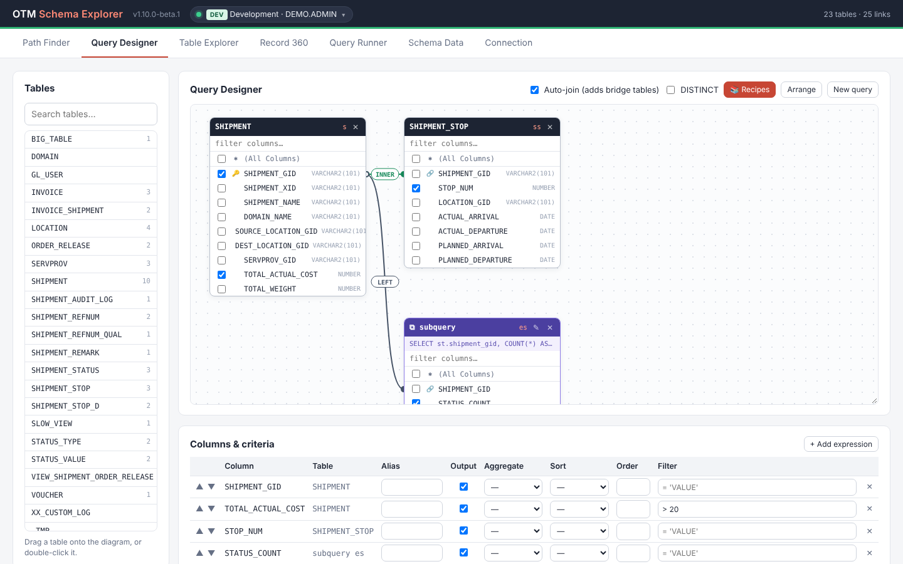
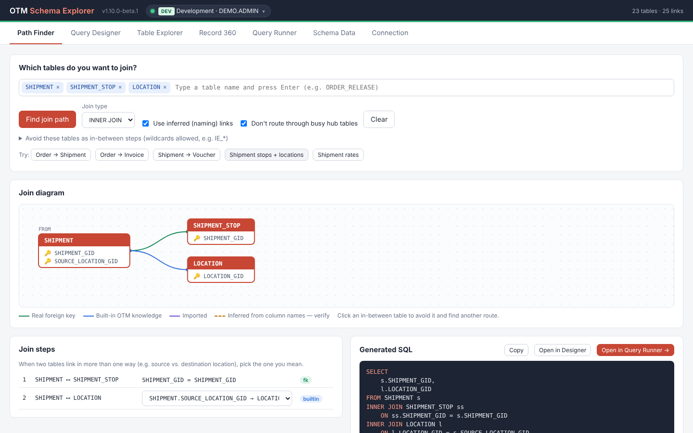
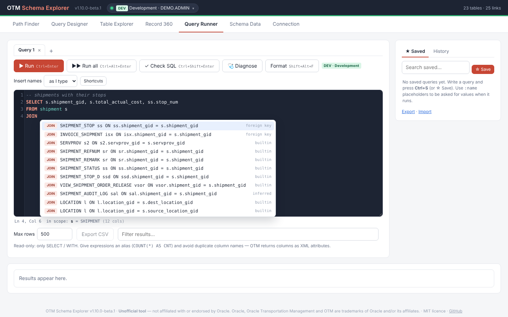
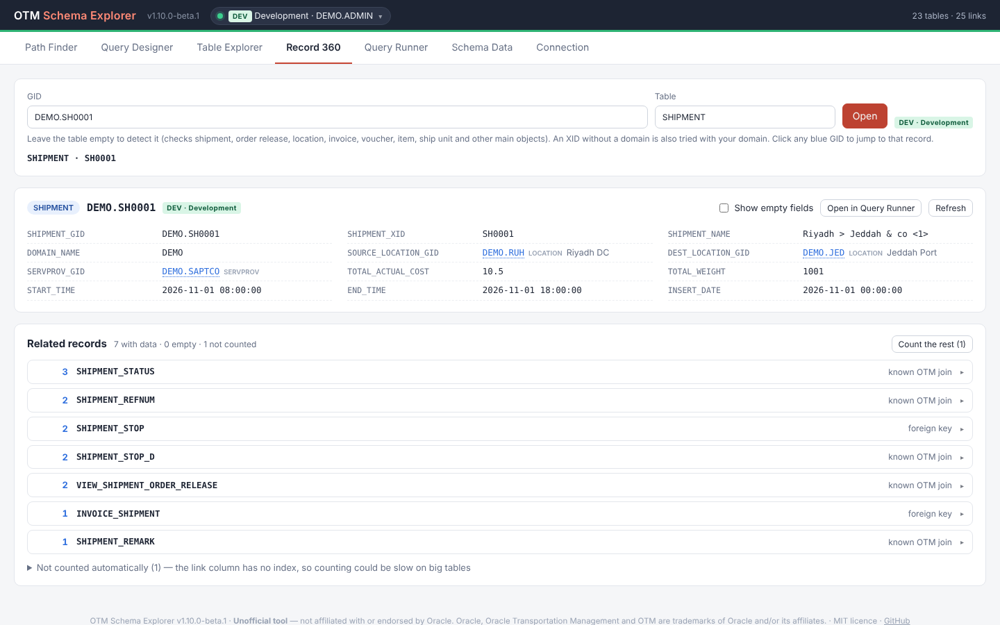
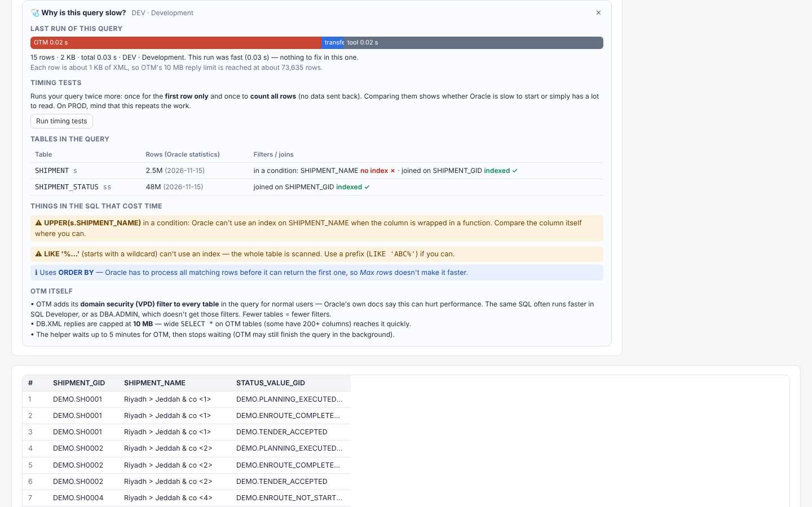

# OTM Schema Explorer

[](https://github.com/omarmahmoudeidmosbah-lgtm/otm-schema-explorer/actions/workflows/ci.yml)


> **Unofficial tool — not affiliated with or endorsed by Oracle.** Oracle, Oracle Transportation Management and OTM are trademarks of Oracle and/or its affiliates.

A single-file tool for people who write SQL against **Oracle Transportation Management (OTM)**. OTM doesn't show how its tables relate, so finding the right joins takes time. This tool finds them for you, helps you build and check queries, and runs them read-only against your own OTM instance.



## What it does

- **Path Finder.** Pick two or more tables and get the join path, a diagram and ready-to-run SQL. Bridge tables are added for you.
- **Query Designer.** Works like the designer in SQL Server Management Studio: drag tables, tick columns, set filters, grouping and sorting.
  - The SQL box is editable and syncs back to the diagram. A subquery you type becomes a derived-table box with its join.
  - Steps add window functions (ROW_NUMBER, LAG/LEAD, running totals…), and recipes build common OTM patterns from a short form.
- **SQL editor.**
  - Autocomplete from your schema: `s.` lists SHIPMENT's columns, and after `JOIN` it suggests the tables that link, with the ON condition filled in.
  - Real values from your instance after `= '` (status values, refnum qualifiers…).
  - Format, and **Check SQL**, which lets Oracle validate the query without reading data.
  - Tabs, Run all, and saved queries with `:parameters`.
- **Record 360.** Paste any GID and see the record, its statuses and refnums, and every related record. Click through from one record to the next.
- **Diagnose.** A breakdown of where a slow query's time goes (OTM, transfer, this tool), table sizes, index checks and the SQL patterns that cost time.
- **Environments.** Save DEV, TEST and PROD connections. PROD is shown in red, and passwords are never saved.

| | |
|---|---|
|  |  |
|  |  |

## Requirements

- **Python 3.10 or newer.** Nothing else to install.
- **An OTM user that can use the DB.XML servlet** with a password (HTTP Basic Auth). Users who can only sign in through single sign-on can't connect this way, so ask your OTM administrator for a suitable integration user.
- **A modern browser** (Chrome, Edge, Firefox or Safari).

## Quick start

1. Download `otm_explorer.py` from the [Releases](https://github.com/omarmahmoudeidmosbah-lgtm/otm-schema-explorer/releases) page. You can compare its SHA-256 with the `.sha256` file published next to it.
2. Run it:
   ```
   python otm_explorer.py
   ```
   Your browser opens with a one-time launch link. If you need a new link, press **Enter** in the helper window.
3. **Connection** tab: enter your OTM URL, your user as `DOMAIN.USER` and your password, then click **Connect & test**.
4. **Schema Data** tab: click **Sync now**, with *All columns* ticked. This reads your instance's tables, keys and columns (about a minute).

The [user guide](docs/USER_GUIDE.md) explains every feature.

## Security and privacy

- **It runs on your computer.** It only talks to the OTM URL you enter. There is no telemetry, no account and no other server, and every library is bundled in the file.
- **Passwords stay in the helper's memory** and are never written to disk. TLS certificates are verified unless you tick *Skip TLS certificate check*, which is meant only for on-premise test systems.
- **Only the browser opened with the launch link** can use the helper. Other programs or other users on the same computer can't reach your OTM session, and other websites can't send it requests.
- **Read-only.** Only `SELECT` / `WITH` statements are sent, but that check is a convenience, not a security boundary. What your OTM user is allowed to do is the real control.
- **What it stores:**
  - Next to the script: `otm_schema_cache.json` (your instance's tables and columns, no business data) and `otm_saved_queries.json` (your saved SQL).
  - In your browser: environments (name, URL, user), query tabs and history.
  - Don't commit the two files, or share them by accident.

Found a security problem? See [SECURITY.md](SECURITY.md).

## Good to know

- **DB.XML replies are capped at 10 MB by OTM.** Select the columns you need rather than `SELECT *` on wide OTM tables.
- **OTM adds its domain security (VPD) filter to every table** in a query for normal users, so the same SQL can be slower here than in SQL Developer.
- **DB.XML has no bind variables.** `:parameters` are filled into the SQL before it's sent.
- **Heavy queries run on your real database.** Try them on DEV or TEST first. *Max rows* doesn't make ORDER BY, GROUP BY or DISTINCT queries faster.
- **Beta.** Every change is tested automatically against a simulated OTM, and earlier versions were used on OTM Cloud 26C. Reports from real instances and other versions (including on-premise 6.4.x) are very welcome: open an issue.

## Build from source

The release file is built from the readable source in this repository:

```
src/server/otm_explorer.py   the helper (Python standard library only)
src/web/                     the page: page.html + the JavaScript parts
third_party/                 CodeMirror 5 and sql-formatter (MIT), with their licences
tools/build.py               puts it all into dist/otm_explorer.py
tests/                       helper tests, browser tests, a mock OTM server
```

```
python tools/build.py                 # -> dist/otm_explorer.py (+ .sha256)
pip install -r tests/requirements-ui.txt
python -m playwright install chromium
python -m pytest tests                # helper + browser tests against the mock OTM
```

Releases are built and tested by GitHub Actions when a version tag (`v1.10.0`, `v1.11.0-beta.1`…) is pushed. See [CONTRIBUTING.md](CONTRIBUTING.md).

## Licence

[MIT](LICENSE) © Omar Mosbah. The bundled libraries are listed in [THIRD_PARTY_NOTICES.md](THIRD_PARTY_NOTICES.md).

This project is not affiliated with, endorsed by or supported by Oracle. Use it according to your organisation's policies and your OTM licence terms.
